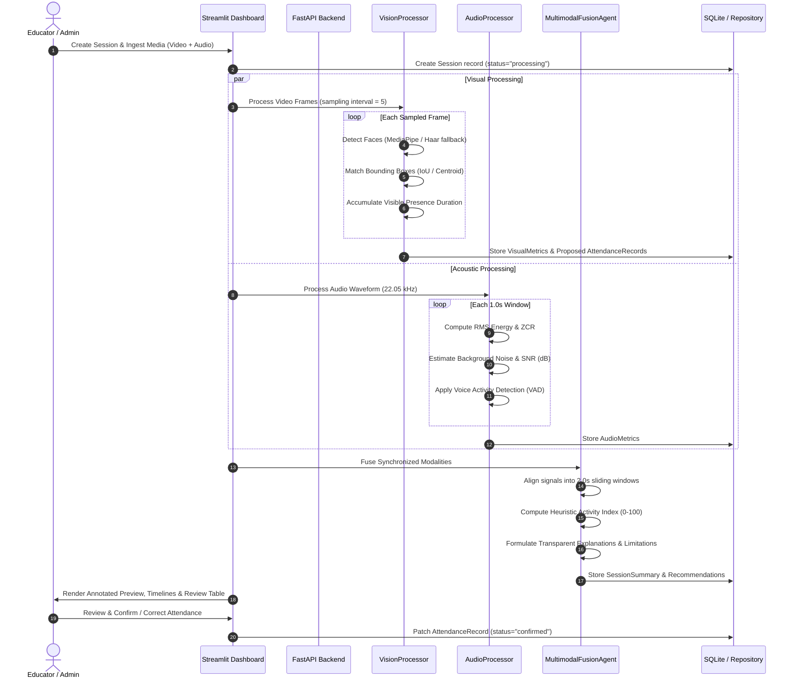
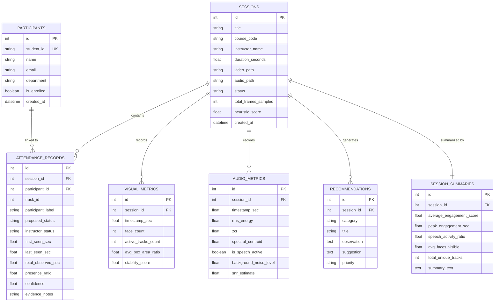

# System Architecture & Technical Specification

## Multimodal Attendance & Engagement Agent

---

## 1. Architectural Overview

The **Multimodal Attendance & Engagement Agent** is structured around a decoupled, offline-first layered architecture. It cleanly separates low-level signal ingestion, computer vision tracking, audio signal processing, rule-based signal fusion, relational persistence, and presentation layers.

```mermaid
graph TD
    subgraph DataIngestion["1. Data Ingestion Layer"]
        V[Video Stream / Upload / Webcam]
        A[Audio Stream / Upload / Mic]
    end

    subgraph ProcessingLayer["2. Feature Processing Layer"]
        subgraph VisionEngine["Vision Subsystem"]
            FD[Face Detection<br/>MediaPipe / Haar Cascade / Contour]
            TR[Centroid & IoU Multi-Object Tracker]
            PA[Presence Accumulator]
        end
        subgraph AudioEngine["Audio Subsystem"]
            AFE[Acoustic Feature Extractor<br/>RMS, ZCR, Centroid, SNR]
            VAD[Voice Activity Detection Heuristic]
        end
    end

    subgraph FusionAgent["3. Multimodal Signal Fusion Layer"]
        SYN[Temporal Window Synchronizer (2.0s)]
        ENG[Heuristic Engagement Index Calculator]
        REC[Pedagogical Recommendation Engine]
    end

    subgraph Persistence["4. Persistence Layer"]
        ORM[SQLAlchemy 2.0 ORM Engine]
        DB[(Local SQLite Database)]
    end

    subgraph InterfaceLayer["5. Application Interface Layer"]
        API[FastAPI Backend Server (:8000)]
        UI[Streamlit Web Dashboard (:8501)]
    end

    V --> FD --> TR --> PA
    A --> AFE --> VAD
    PA --> SYN
    VAD --> SYN
    SYN --> ENG --> ORM
    SYN --> REC --> ORM
    ORM --> DB
    DB --> API
    DB --> UI
```

---

## 2. Sequence of Execution & Data Flow



---

## 3. Mathematical Formulations & Heuristics

### 3.1 Bounding Box IoU
The Intersection-over-Union between a tracked box $B_1$ and candidate detection $B_2$ is computed as:

$$\text{IoU}(B_1, B_2) = \frac{\text{Area}(B_1 \cap B_2)}{\text{Area}(B_1 \cup B_2)} = \frac{\text{Area}(B_1 \cap B_2)}{\text{Area}(B_1) + \text{Area}(B_2) - \text{Area}(B_1 \cap B_2)}$$

If $\text{IoU} \ge 0.25$, the detection is associated with the existing track. If multiple candidate boxes overlap, association minimizes Euclidean centroid distance:

$$d(c_1, c_2) = \sqrt{(x_1 - x_2)^2 + (y_1 - y_2)^2}$$

### 3.2 Acoustic Voice Activity Detection (VAD)
A temporal window $w$ is classified as containing speech ($\text{VAD}_w = 1$) if all four criteria are satisfied simultaneously:

$$\text{VAD}_w = \begin{cases} 
1, & \text{if } \text{RMS}_w > \tau_{\text{abs}} \land \text{RMS}_w > 1.8 \cdot N_0 \land 0.02 \le \text{ZCR}_w \le 0.35 \land 250 \text{ Hz} \le f_{\text{centroid}} \le 4500 \text{ Hz} \\
0, & \text{otherwise}
\end{cases}$$

Where:
- $\tau_{\text{abs}} = 0.015$ (absolute minimum RMS threshold).
- $N_0$ is the ambient noise floor, estimated as the 15th percentile of RMS across the audio stream.
- $\text{ZCR}$ is the Zero-Crossing Rate.
- $f_{\text{centroid}}$ is the spectral centroid frequency in Hertz.

### 3.3 Multimodal Activity Heuristic Formulation
The experimental classroom heuristic indicator $H \in [0, 100]$ combines four weighted physical proxies:

$$H_w = w_{\text{pres}} \cdot S_{\text{pres}} + w_{\text{stab}} \cdot S_{\text{stab}} + w_{\text{speech}} \cdot S_{\text{speech}} + w_{\text{snr}} \cdot S_{\text{snr}}$$

Standard default weights:
- $w_{\text{pres}} = 0.40$ (Visual Face Presence)
- $w_{\text{stab}} = 0.25$ (Tracking Continuity & Stability)
- $w_{\text{speech}} = 0.20$ (Vocal Discussion Dynamic)
- $w_{\text{snr}} = 0.15$ (Acoustic Signal Clarity)

**Modality Fallback Normalization:**
When only video is provided ($M = \{\text{video}\}$):
$$H_w = \frac{w_{\text{pres}} S_{\text{pres}} + w_{\text{stab}} S_{\text{stab}}}{w_{\text{pres}} + w_{\text{stab}}}$$

When only audio is provided ($M = \{\text{audio}\}$):
$$H_w = \frac{w_{\text{speech}} S_{\text{speech}} + w_{\text{snr}} S_{\text{snr}}}{w_{\text{speech}} + w_{\text{snr}}}$$

---

## 4. Relational Database Schema (ER Diagram)



---

## 5. REST API Specification

| Method | Endpoint | Description | Status Codes |
|---|---|---|---|
| `GET` | `/health` | Server status and environment diagnostics | `200` |
| `POST` | `/api/sessions` | Create new observation session metadata | `201`, `422` |
| `GET` | `/api/sessions` | List sessions with pagination limit | `200` |
| `GET` | `/api/sessions/{id}` | Retrieve specific session metadata | `200`, `404` |
| `POST` | `/api/sessions/upload` | Upload video or audio file for session | `200`, `400`, `404` |
| `POST` | `/api/sessions/{id}/analyze` | Execute vision and audio multimodal analysis | `200`, `400`, `404`, `500` |
| `GET` | `/api/sessions/{id}/analytics` | Retrieve metrics, timeline, and suggestions | `200`, `404` |
| `GET` | `/api/sessions/{id}/attendance` | Retrieve proposed attendance roster | `200`, `404` |
| `PATCH`| `/api/attendance/{id}` | Instructor review (confirm/correct/reject) | `200`, `400`, `404` |
| `GET` | `/api/sessions/{id}/export` | Download CSV (`export_type=attendance\|metrics`) | `200`, `404` |
| `POST` | `/api/participants` | Enroll consented student profile | `201`, `400` |
| `GET` | `/api/participants` | List registered student roster | `200` |
